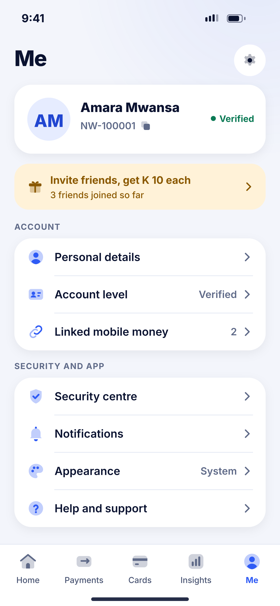
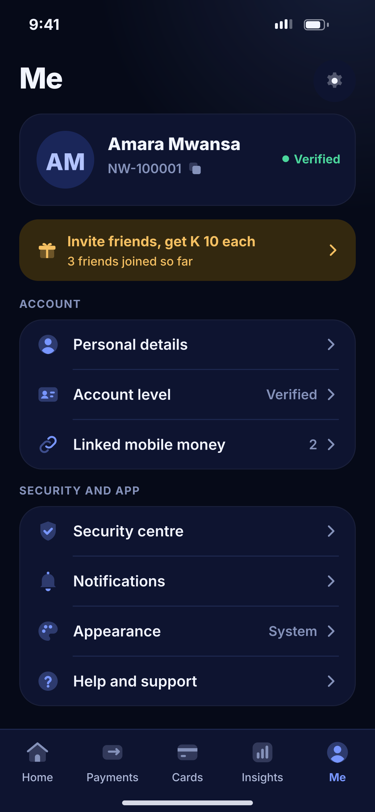

# O01 · Me

**Flow:** Me and settings  
**Route:** `/me (tab)`  
**Design files:** `light.png`, `dark.png` (3×, 1170 × 2532) and `light.svg`, `dark.svg` in this folder.

| Light | Dark |
|---|---|
|  |  |

## Purpose
Fifth tab: profile, account and settings.

## Layout (top to bottom, 390 × 844 canvas, 20 side padding)
1. Large title “Me” + settings icon button.
2. Profile card: avatar 30, name 18/800, account number + copy icon, Verified pill.
3. Gold invite banner with chevron.
4. Overline Account + list group (52 rows): Personal details, Account level (Verified), Linked mobile money (2).
5. Overline Security and app + list: Security centre, Notifications, Appearance (System), Help and support.
6. More rows below (scroll): Privacy and data, Language, Statements, Close account, Sign out, app version.
7. NwTabBar Me active.

## Components used (see ../../../docs/COMPONENTS.md)
- NwCard
- NwListGroup
- NwTabBar

## States and behaviour
- Sign out asks to confirm in a sheet.

## Navigation
| When | Go to |
|---|---|
| Rows | O02, D02, O06, O03, O07, O08, O10, O12, J05, O13 |
| Invite | O09 |

## Data and backend
- `GET /api/v1/users/me`.

## Done when
- Matches `light.png` and `dark.png` side by side at 390 × 844 (spacing within 2 px, same colours from theme tokens).
- Works at text scale 1.3× without clipping, and on a 360-wide Android phone.
- Every state listed above can be reached (use a debug menu or fake repository).
- TalkBack reads every button and field with a clear label.
- No hard-coded colours, strings (all in ARB files) or limits.

## Prompt to give opencode (paste as is)
```text
Build screen O01 "Me" for the NovaWallet Flutter app (route /me (tab)).
Read docs/COMPONENTS.md and this file (screens/.../O01_me/BUILD.md) first, and open light.png and dark.png to match the design exactly.
Use only the shared components from lib/core/ui and colours from the theme extension; if a component is missing, build it in lib/core/ui first.
Put the screen in the feature folder for "Me and settings" following the existing architecture (presentation / application / data layers, Riverpod for state, go_router for navigation).
Implement every state listed under "States and behaviour", the navigation table, and the data calls listed under "Data and backend" through a repository interface with a fake implementation for now if the endpoint is marked NEW.
Add all text to the ARB localisation files. Add a widget test that pumps the screen in light and dark and a golden test for each.
Do not change other screens. When finished, list the files you created or changed and anything you could not complete.
```
