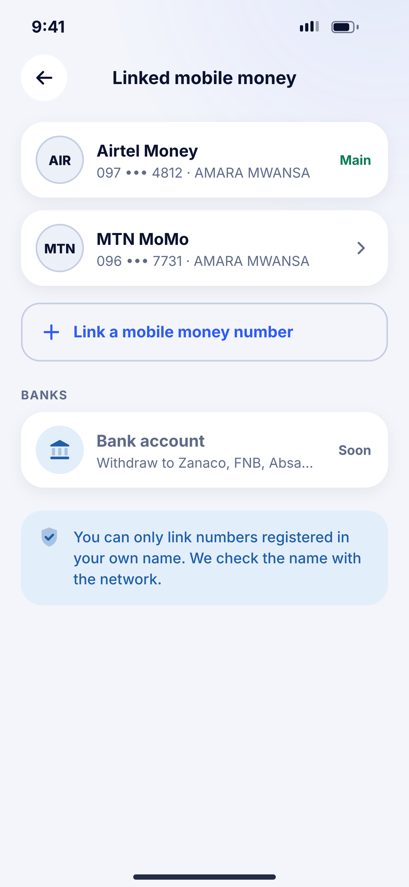
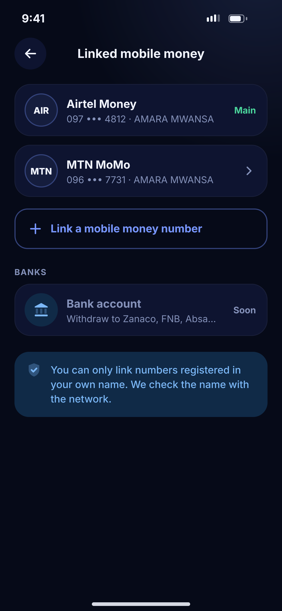

# O06 · Linked mobile money

**Flow:** Me and settings  
**Route:** `/me/linked`  
**Design files:** `light.png`, `dark.png` (3×, 1170 × 2532) and `light.svg`, `dark.svg` in this folder.

| Light | Dark |
|---|---|
|  |  |

## Purpose
Manage numbers used for top up and withdrawal.

## Layout (top to bottom, 390 × 844 canvas, 20 side padding)
1. TopBar “Linked mobile money”.
2. Provider rows with name on account; main number has a success “Main” pill.
3. Outline “Link a mobile money number”.
4. Overline Banks + greyed Bank account “Soon”.
5. Info banner: only numbers in your own name.

## Components used (see ../../../docs/COMPONENTS.md)
- Provider row
- NwBanner

## States and behaviour
- Row tap → sheet: Make main, Remove.
- Name mismatch on link → error “This number isn’t registered in your name.”

## Navigation
| When | Go to |
|---|---|
| Link | Number + OTP + name check |

## Data and backend
- NEW `GET/POST/DELETE /api/v1/payment-accounts`.

## Done when
- Matches `light.png` and `dark.png` side by side at 390 × 844 (spacing within 2 px, same colours from theme tokens).
- Works at text scale 1.3× without clipping, and on a 360-wide Android phone.
- Every state listed above can be reached (use a debug menu or fake repository).
- TalkBack reads every button and field with a clear label.
- No hard-coded colours, strings (all in ARB files) or limits.

## Prompt to give opencode (paste as is)
```text
Build screen O06 "Linked mobile money" for the NovaWallet Flutter app (route /me/linked).
Read docs/COMPONENTS.md and this file (screens/.../O06_linked_accounts/BUILD.md) first, and open light.png and dark.png to match the design exactly.
Use only the shared components from lib/core/ui and colours from the theme extension; if a component is missing, build it in lib/core/ui first.
Put the screen in the feature folder for "Me and settings" following the existing architecture (presentation / application / data layers, Riverpod for state, go_router for navigation).
Implement every state listed under "States and behaviour", the navigation table, and the data calls listed under "Data and backend" through a repository interface with a fake implementation for now if the endpoint is marked NEW.
Add all text to the ARB localisation files. Add a widget test that pumps the screen in light and dark and a golden test for each.
Do not change other screens. When finished, list the files you created or changed and anything you could not complete.
```
