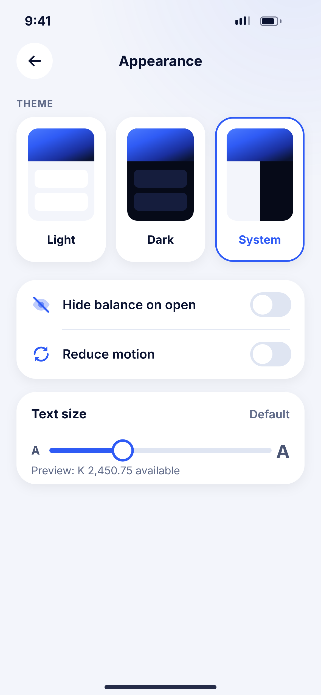
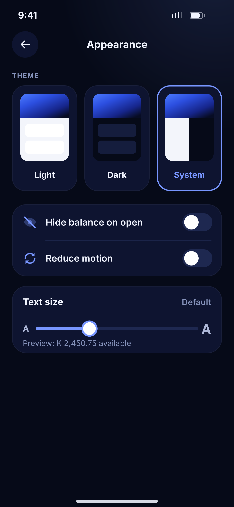

# O08 · Appearance

**Flow:** Me and settings  
**Route:** `/me/appearance`  
**Design files:** `light.png`, `dark.png` (3×, 1170 × 2532) and `light.svg`, `dark.svg` in this folder.

| Light | Dark |
|---|---|
|  |  |

## Purpose
Theme, privacy on open, motion and text size.

## Layout (top to bottom, 390 × 844 canvas, 20 side padding)
1. TopBar “Appearance”.
2. Three theme cards with mini previews (Light, Dark, System split); selected has primary border and primary label.
3. Toggles: Hide balance on open, Reduce motion.
4. Text size card: small A — slider — large A, preview line.

## Components used (see ../../../docs/COMPONENTS.md)
- Theme card
- NwToggle
- Slider

## States and behaviour
- Theme switches instantly with a 250 ms cross-fade.

## Navigation
| When | Go to |
|---|---|

## Data and backend
- Local settings.

## Rules and notes
- Text size multiplies the system scale, capped at 1.3×.

## Done when
- Matches `light.png` and `dark.png` side by side at 390 × 844 (spacing within 2 px, same colours from theme tokens).
- Works at text scale 1.3× without clipping, and on a 360-wide Android phone.
- Every state listed above can be reached (use a debug menu or fake repository).
- TalkBack reads every button and field with a clear label.
- No hard-coded colours, strings (all in ARB files) or limits.

## Prompt to give opencode (paste as is)
```text
Build screen O08 "Appearance" for the NovaWallet Flutter app (route /me/appearance).
Read docs/COMPONENTS.md and this file (screens/.../O08_appearance/BUILD.md) first, and open light.png and dark.png to match the design exactly.
Use only the shared components from lib/core/ui and colours from the theme extension; if a component is missing, build it in lib/core/ui first.
Put the screen in the feature folder for "Me and settings" following the existing architecture (presentation / application / data layers, Riverpod for state, go_router for navigation).
Implement every state listed under "States and behaviour", the navigation table, and the data calls listed under "Data and backend" through a repository interface with a fake implementation for now if the endpoint is marked NEW.
Add all text to the ARB localisation files. Add a widget test that pumps the screen in light and dark and a golden test for each.
Do not change other screens. When finished, list the files you created or changed and anything you could not complete.
```
