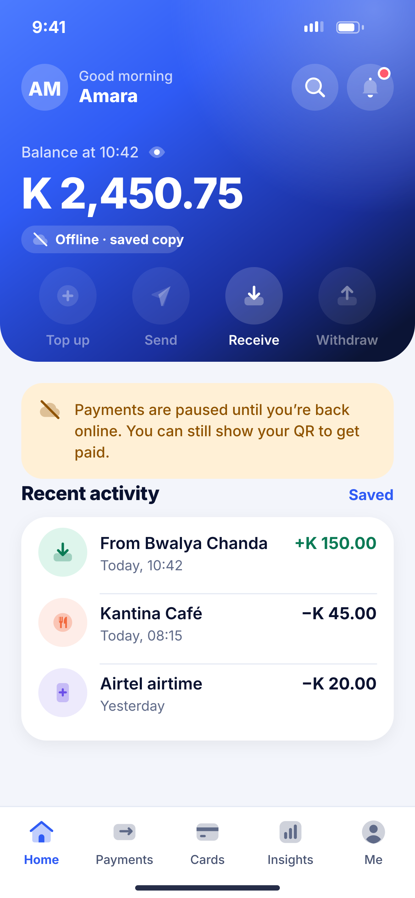
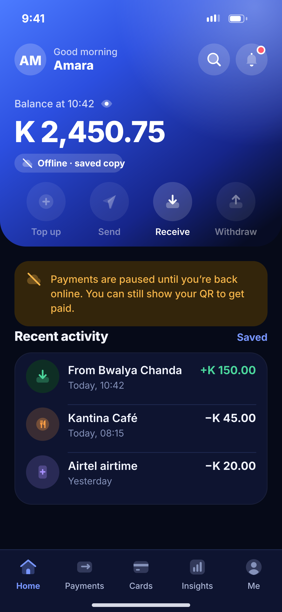

# P02 · Home – offline

**Flow:** Offline and system  
**Route:** `/home`  
**Design files:** `light.png`, `dark.png` (3×, 1170 × 2532) and `light.svg`, `dark.svg` in this folder.

| Light | Dark |
|---|---|
|  |  |

## Purpose
Home with saved data while offline.

## Layout (top to bottom, 390 × 844 canvas, 20 side padding)
1. Hero label “Balance at 10:42” (time of last update), glass pill with offline icon “Offline · saved copy”.
2. Top up, Send and Withdraw at 45% opacity; Receive stays active (QR works offline).
3. Warning banner: payments are paused, QR still works.
4. Recent activity from cache, action label “Saved”.

## Components used (see ../../../docs/COMPONENTS.md)
- NwHeroHeader
- NwBanner

## States and behaviour
- Tap a dimmed action → snackbar “Connect to the internet to do this.”

## Navigation
| When | Go to |
|---|---|
| Back online | P09 toast then E02 |

## Data and backend
- Local cache (Drift/Isar) of last balance and 50 transactions.

## Rules and notes
- Never show a cached balance without its time.

## Done when
- Matches `light.png` and `dark.png` side by side at 390 × 844 (spacing within 2 px, same colours from theme tokens).
- Works at text scale 1.3× without clipping, and on a 360-wide Android phone.
- Every state listed above can be reached (use a debug menu or fake repository).
- TalkBack reads every button and field with a clear label.
- No hard-coded colours, strings (all in ARB files) or limits.

## Prompt to give opencode (paste as is)
```text
Build screen P02 "Home – offline" for the NovaWallet Flutter app (route /home).
Read docs/COMPONENTS.md and this file (screens/.../P02_home_offline/BUILD.md) first, and open light.png and dark.png to match the design exactly.
Use only the shared components from lib/core/ui and colours from the theme extension; if a component is missing, build it in lib/core/ui first.
Put the screen in the feature folder for "Offline and system" following the existing architecture (presentation / application / data layers, Riverpod for state, go_router for navigation).
Implement every state listed under "States and behaviour", the navigation table, and the data calls listed under "Data and backend" through a repository interface with a fake implementation for now if the endpoint is marked NEW.
Add all text to the ARB localisation files. Add a widget test that pumps the screen in light and dark and a golden test for each.
Do not change other screens. When finished, list the files you created or changed and anything you could not complete.
```
