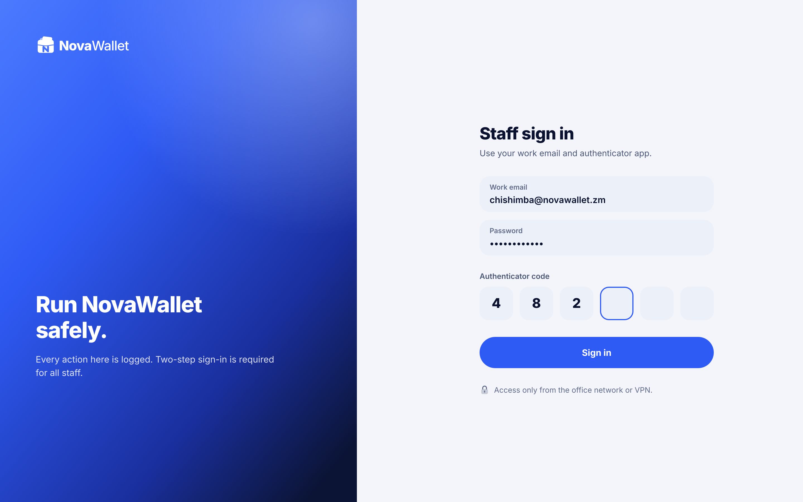
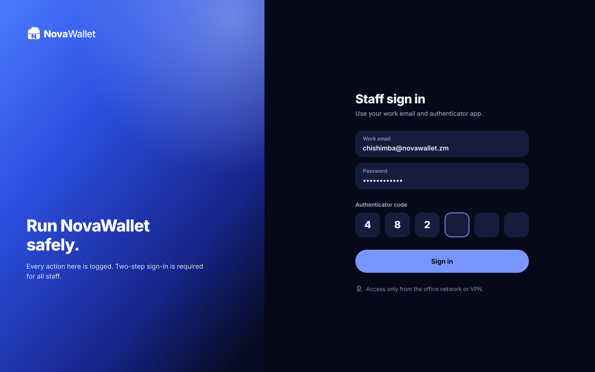

# X01 · Staff sign in (admin console)

**Route:** `/login`  
**Canvas:** 1440 × 900 web, light and dark. Sidebar 248, content padding 32.

| Light | Dark |
|---|---|
|  |  |

## Purpose
Staff sign in with work email, password and an authenticator (TOTP) code.

## Layout
1. Left: hero gradient panel 640 wide with white logo and "Run NovaWallet safely."
2. Right: form 420 wide: email, password, 6 TOTP boxes, primary Sign in, note about office network/VPN.

## Behaviour
- Wrong details: generic error.
- 5 failures → account locked 15 min and alert to super admins.
- TOTP setup on first login (QR + backup codes).

## Backend
- NEW `POST /api/v1/admin/auth/login` → requires TOTP; separate admin JWT audience; short access token (15 min).

## Rules
- Admin auth must be separate from customer auth (different JWT audience/issuer and roles).
- Restrict by IP allowlist / VPN at the gateway.

## Prompt to give opencode
```text
Build admin screen X01 "Staff sign in" at route /login in the admin web app.
Read admin/docs/ADMIN_GUIDE.md and this BUILD.md first; open light.png and dark.png and match them.
Use the shared admin layout (sidebar, top bar, panel, data table, status text) and theme tokens only.
Implement the behaviour list, call the endpoints listed under Backend through the API client (mock any marked NEW until the backend step is done), check the user's role before showing actions, and write every action to the audit log endpoint.
Add tests (component + one end-to-end happy path). Run lint and tests, fix errors, list changed files and anything unfinished.
```
