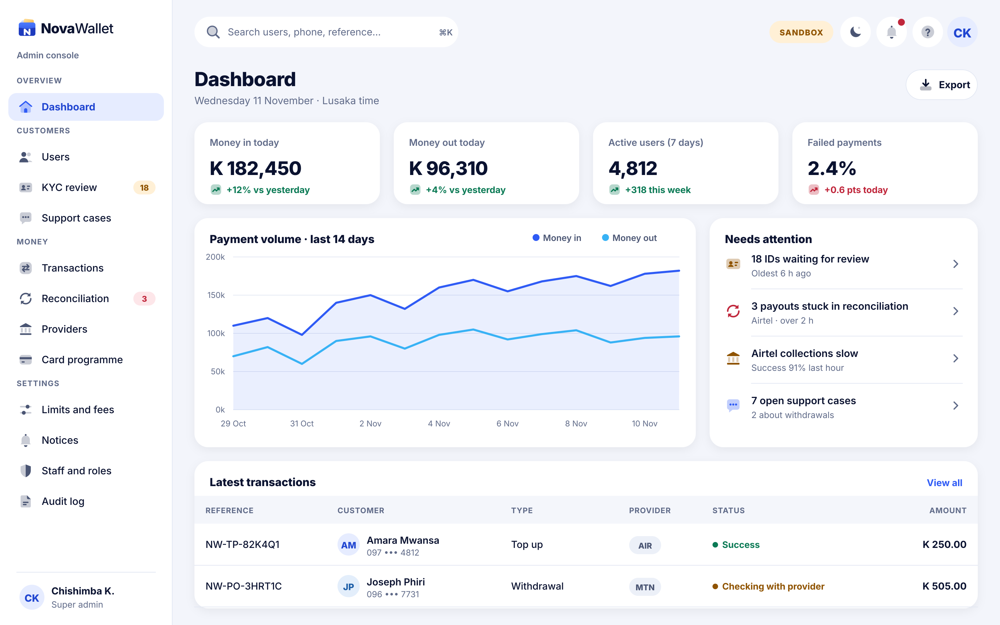
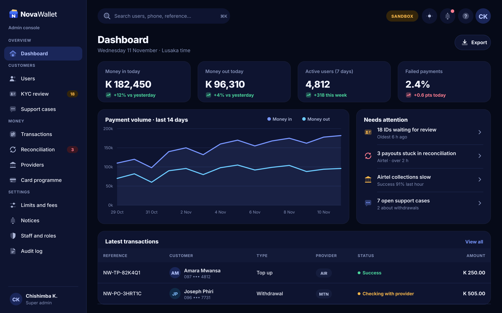

# X02 · Dashboard (admin console)

**Route:** `/`  
**Canvas:** 1440 × 900 web, light and dark. Sidebar 248, content padding 32.

| Light | Dark |
|---|---|
|  |  |

## Purpose
Daily health of money flows and what needs attention.

## Layout
1. Sidebar (248) + top bar (search ⌘K, SANDBOX/LIVE badge, theme, notifications, help, avatar).
2. Four KPI cards: Money in today, Money out today, Active users (7 days), Failed payments (red when worse).
3. Line chart: money in (area) and money out, 14 days.
4. "Needs attention" list: KYC waiting, stuck payouts, slow provider, open support cases.
5. Latest transactions table.

## Behaviour
- Auto refresh every 60 s.
- Environment badge: SANDBOX (amber) or LIVE (red) so staff never confuse them.

## Backend
- NEW `GET /api/v1/admin/metrics/overview`, `GET /api/v1/admin/alerts`.

## Prompt to give opencode
```text
Build admin screen X02 "Dashboard" at route / in the admin web app.
Read admin/docs/ADMIN_GUIDE.md and this BUILD.md first; open light.png and dark.png and match them.
Use the shared admin layout (sidebar, top bar, panel, data table, status text) and theme tokens only.
Implement the behaviour list, call the endpoints listed under Backend through the API client (mock any marked NEW until the backend step is done), check the user's role before showing actions, and write every action to the audit log endpoint.
Add tests (component + one end-to-end happy path). Run lint and tests, fix errors, list changed files and anything unfinished.
```
