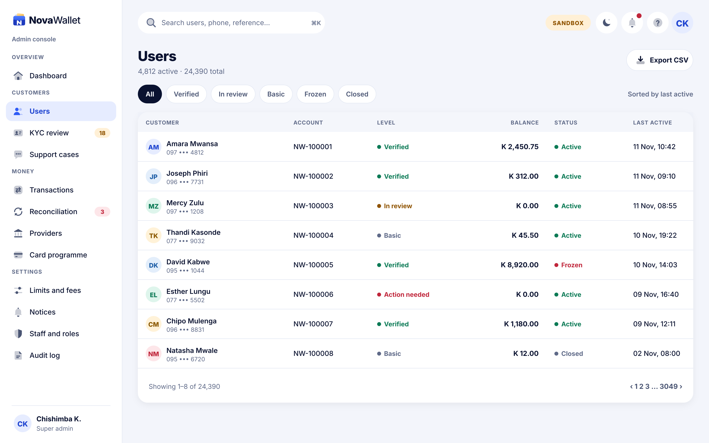
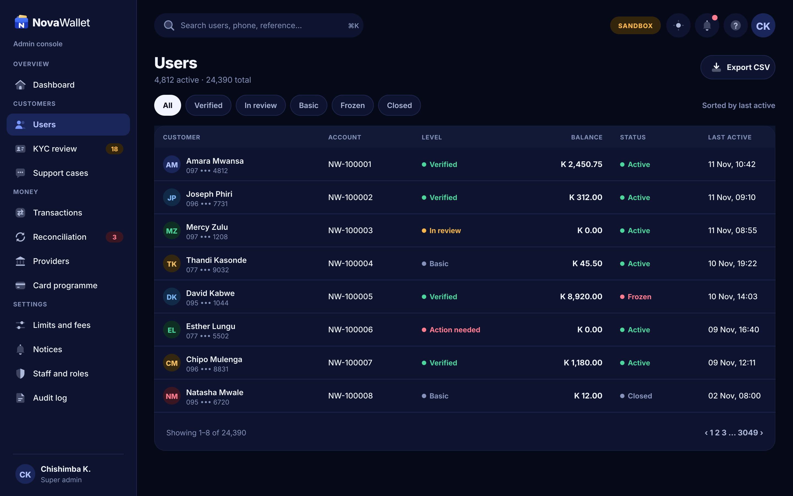

# X03 · Users (admin console)

**Route:** `/users`  
**Canvas:** 1440 × 900 web, light and dark. Sidebar 248, content padding 32.

| Light | Dark |
|---|---|
|  |  |

## Purpose
Find and open customers.

## Layout
1. Filter chips: All, Verified, In review, Basic, Frozen, Closed.
2. Table: customer (avatar, name, masked phone), account, level, balance, status, last active.
3. Pagination.

## Behaviour
- Search by name, phone, account, NRC (exact only).
- Phone numbers masked unless the role allows full view.

## Backend
- Existing `AdminUserController` list endpoint; add filters and search.

## Rules
- Every user view is written to the audit log (who looked at whom).

## Prompt to give opencode
```text
Build admin screen X03 "Users" at route /users in the admin web app.
Read admin/docs/ADMIN_GUIDE.md and this BUILD.md first; open light.png and dark.png and match them.
Use the shared admin layout (sidebar, top bar, panel, data table, status text) and theme tokens only.
Implement the behaviour list, call the endpoints listed under Backend through the API client (mock any marked NEW until the backend step is done), check the user's role before showing actions, and write every action to the audit log endpoint.
Add tests (component + one end-to-end happy path). Run lint and tests, fix errors, list changed files and anything unfinished.
```
