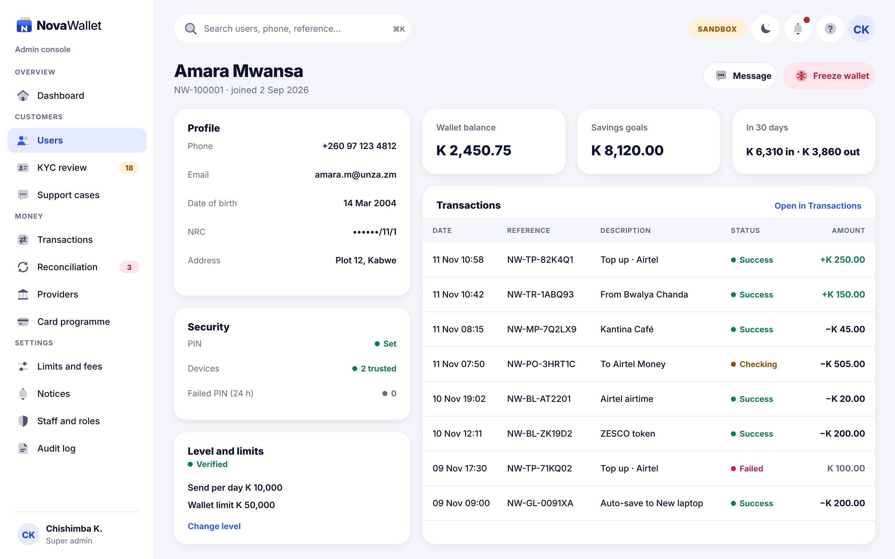
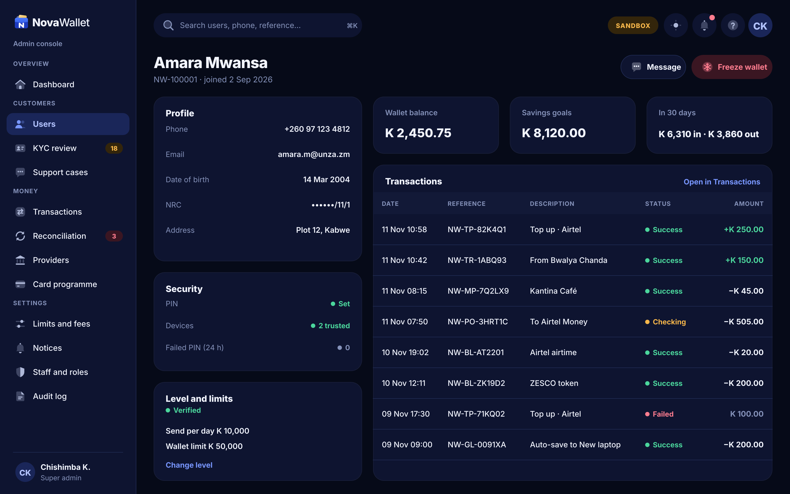

# X04 · User detail (admin console)

**Route:** `/users/:id`  
**Canvas:** 1440 × 900 web, light and dark. Sidebar 248, content padding 32.

| Light | Dark |
|---|---|
|  |  |

## Purpose
Everything about one customer and safe actions.

## Layout
1. Header with Message and Freeze wallet (danger).
2. Left: Profile, Security, Level and limits cards.
3. Right: three stat cards and the customer's transactions table.

## Behaviour
- Freeze → reason dialog (required) → wallet frozen → customer sees a frozen notice.
- Change level → reason + second approver for downgrades.

## Backend
- Existing `AdminWalletController` freeze/unfreeze; `AdminUserController` detail.

## Rules
- No editing of balances. Money is only corrected through ledger adjustments with two approvals.

## Prompt to give opencode
```text
Build admin screen X04 "User detail" at route /users/:id in the admin web app.
Read admin/docs/ADMIN_GUIDE.md and this BUILD.md first; open light.png and dark.png and match them.
Use the shared admin layout (sidebar, top bar, panel, data table, status text) and theme tokens only.
Implement the behaviour list, call the endpoints listed under Backend through the API client (mock any marked NEW until the backend step is done), check the user's role before showing actions, and write every action to the audit log endpoint.
Add tests (component + one end-to-end happy path). Run lint and tests, fix errors, list changed files and anything unfinished.
```
