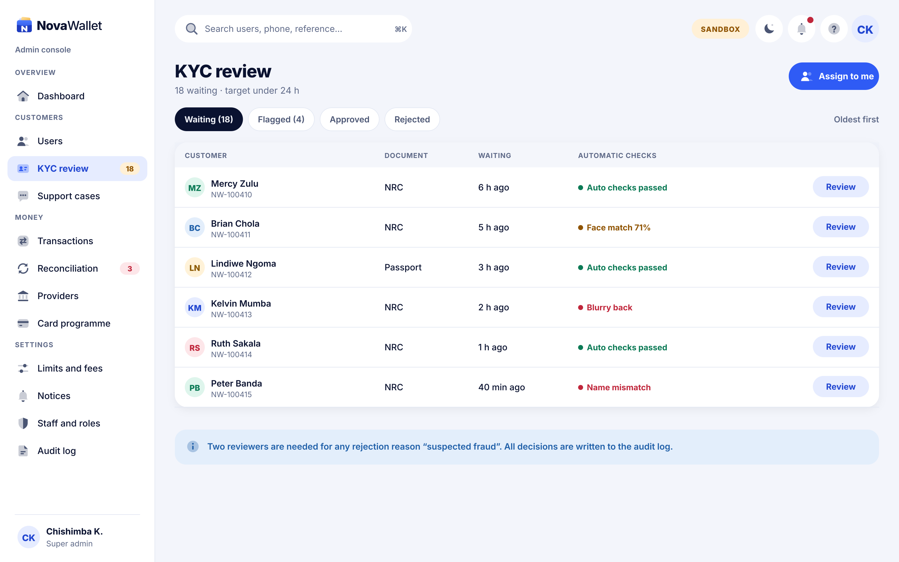
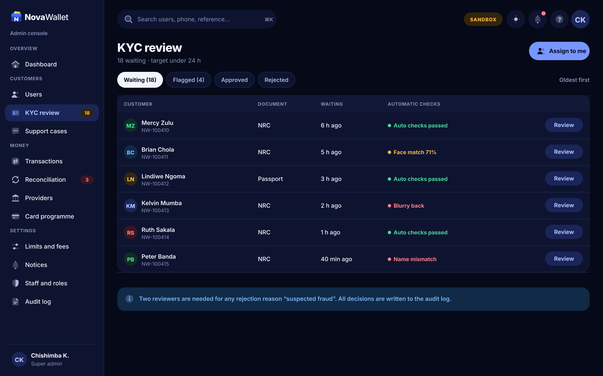

# X05 · KYC review queue (admin console)

**Route:** `/kyc`  
**Canvas:** 1440 × 900 web, light and dark. Sidebar 248, content padding 32.

| Light | Dark |
|---|---|
|  |  |

## Purpose
Queue of identity checks to review.

## Layout
1. Chips: Waiting, Flagged, Approved, Rejected.
2. Table: customer, document, waiting time, automatic checks result (coloured), Review button.
3. Info banner about two-reviewer rule.

## Behaviour
- Oldest first. "Assign to me" locks a case for 15 min so two reviewers do not overlap.

## Backend
- Existing `AdminKycController` list.

## Prompt to give opencode
```text
Build admin screen X05 "KYC review queue" at route /kyc in the admin web app.
Read admin/docs/ADMIN_GUIDE.md and this BUILD.md first; open light.png and dark.png and match them.
Use the shared admin layout (sidebar, top bar, panel, data table, status text) and theme tokens only.
Implement the behaviour list, call the endpoints listed under Backend through the API client (mock any marked NEW until the backend step is done), check the user's role before showing actions, and write every action to the audit log endpoint.
Add tests (component + one end-to-end happy path). Run lint and tests, fix errors, list changed files and anything unfinished.
```
