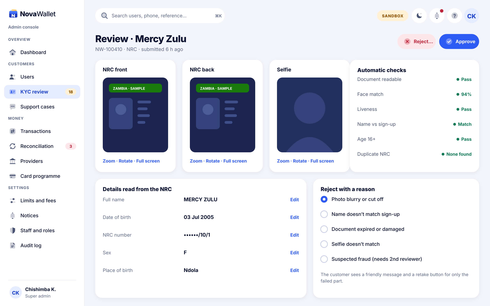
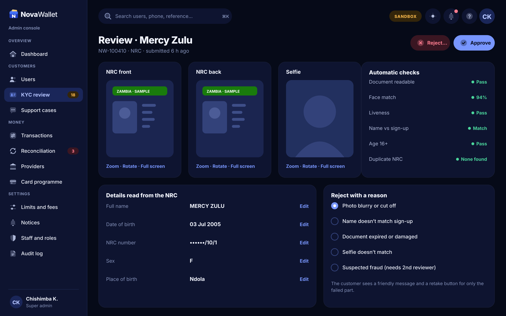

# X06 · KYC review detail (admin console)

**Route:** `/kyc/:id`  
**Canvas:** 1440 × 900 web, light and dark. Sidebar 248, content padding 32.

| Light | Dark |
|---|---|
|  |  |

## Purpose
Approve or reject one submission.

## Layout
1. NRC front, NRC back, Selfie image panels with zoom/rotate.
2. Automatic checks panel (readable, face match %, liveness, name, age, duplicate NRC).
3. Details read from the NRC (editable).
4. Reject reasons (radio) with explanation.
5. Header: Reject…, Approve.

## Behaviour
- Approve → customer pushed D08.
- Reject → customer pushed D09 with the friendly message for the chosen reason.
- "Suspected fraud" needs a second reviewer.

## Backend
- Existing `AdminKycController` approve/reject; add reason codes and signed, expiring image URLs.

## Rules
- Images are never downloadable by default; screenshots discouraged; access logged.

## Prompt to give opencode
```text
Build admin screen X06 "KYC review detail" at route /kyc/:id in the admin web app.
Read admin/docs/ADMIN_GUIDE.md and this BUILD.md first; open light.png and dark.png and match them.
Use the shared admin layout (sidebar, top bar, panel, data table, status text) and theme tokens only.
Implement the behaviour list, call the endpoints listed under Backend through the API client (mock any marked NEW until the backend step is done), check the user's role before showing actions, and write every action to the audit log endpoint.
Add tests (component + one end-to-end happy path). Run lint and tests, fix errors, list changed files and anything unfinished.
```
