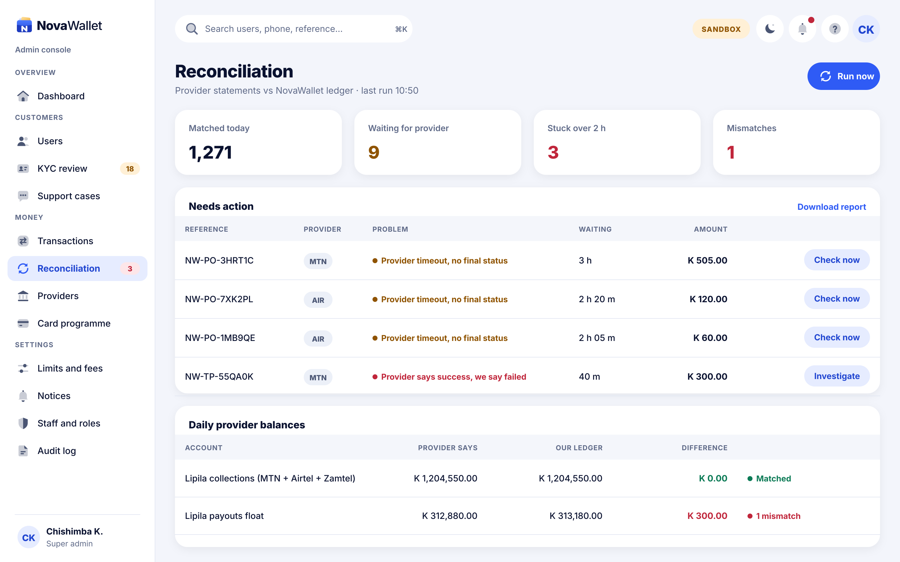
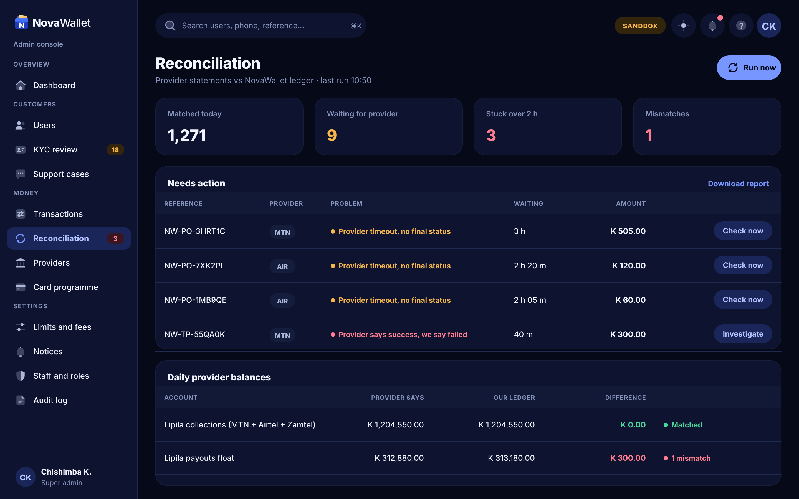

# X09 · Reconciliation (admin console)

**Route:** `/reconciliation`  
**Canvas:** 1440 × 900 web, light and dark. Sidebar 248, content padding 32.

| Light | Dark |
|---|---|
|  |  |

## Purpose
Match provider records against the ledger.

## Layout
1. KPI cards: matched, waiting, stuck over 2 h, mismatches.
2. Needs action table with Check now / Investigate.
3. Daily provider balances: provider says vs our ledger vs difference.

## Behaviour
- Run now triggers the reconciliation job.
- Mismatch → creates an incident and alerts Finance.

## Backend
- Backend Phase 1B Batch 3 reconciliation scheduler + NEW admin endpoints.

## Prompt to give opencode
```text
Build admin screen X09 "Reconciliation" at route /reconciliation in the admin web app.
Read admin/docs/ADMIN_GUIDE.md and this BUILD.md first; open light.png and dark.png and match them.
Use the shared admin layout (sidebar, top bar, panel, data table, status text) and theme tokens only.
Implement the behaviour list, call the endpoints listed under Backend through the API client (mock any marked NEW until the backend step is done), check the user's role before showing actions, and write every action to the audit log endpoint.
Add tests (component + one end-to-end happy path). Run lint and tests, fix errors, list changed files and anything unfinished.
```
