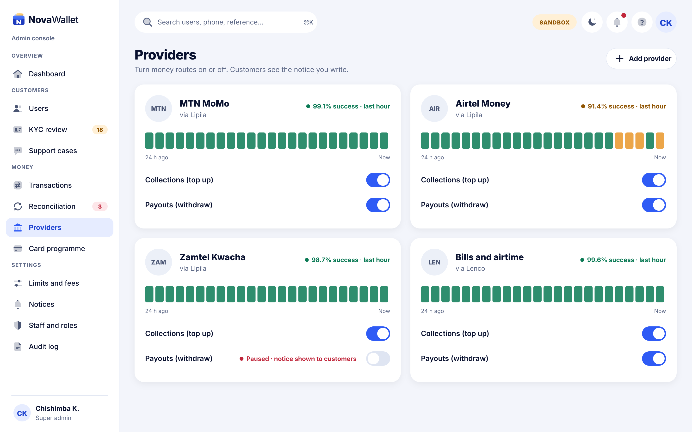
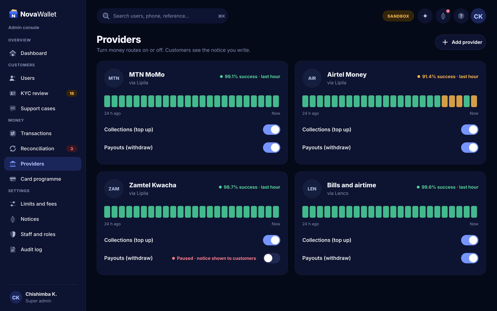

# X10 · Providers (kill switch) (admin console)

**Route:** `/providers`  
**Canvas:** 1440 × 900 web, light and dark. Sidebar 248, content padding 32.

| Light | Dark |
|---|---|
|  |  |

## Purpose
Turn collections/payouts per provider on or off, see health.

## Layout
1. Card per provider: code badge, name, via (Lipila/Lenco), success rate, 24 h health bars, toggles for Collections and Payouts.
2. Paused route shows "Paused · notice shown to customers".

## Behaviour
- Toggling off asks for a customer message (prefilled) and creates a notice (X12).
- Health from provider success rate per hour.

## Backend
- NEW provider_routes table + `GET/PUT /api/v1/admin/providers`; app reads `/app/notices` and `/payment-methods`.

## Prompt to give opencode
```text
Build admin screen X10 "Providers (kill switch)" at route /providers in the admin web app.
Read admin/docs/ADMIN_GUIDE.md and this BUILD.md first; open light.png and dark.png and match them.
Use the shared admin layout (sidebar, top bar, panel, data table, status text) and theme tokens only.
Implement the behaviour list, call the endpoints listed under Backend through the API client (mock any marked NEW until the backend step is done), check the user's role before showing actions, and write every action to the audit log endpoint.
Add tests (component + one end-to-end happy path). Run lint and tests, fix errors, list changed files and anything unfinished.
```
