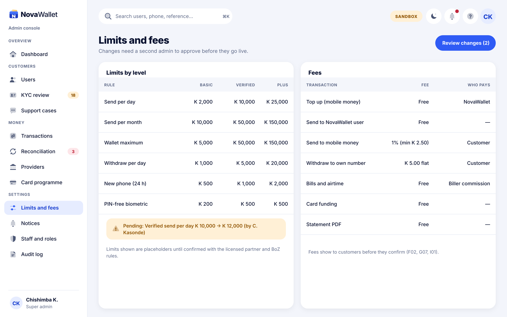
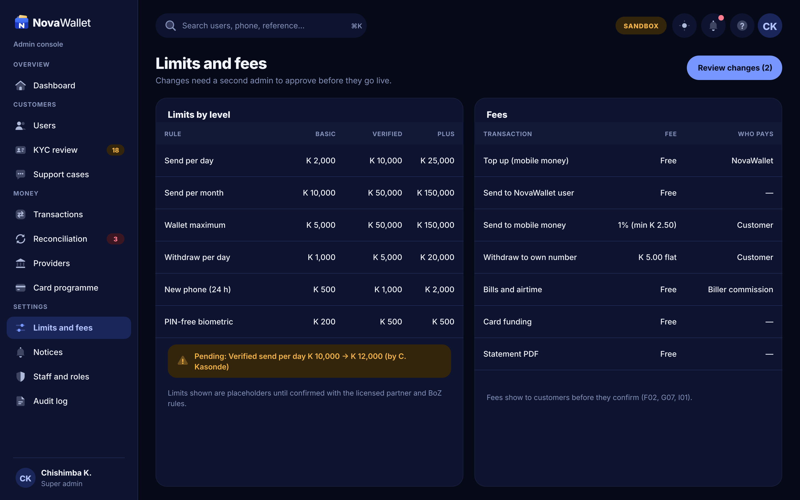

# X11 · Limits and fees (admin console)

**Route:** `/settings/limits`  
**Canvas:** 1440 × 900 web, light and dark. Sidebar 248, content padding 32.

| Light | Dark |
|---|---|
|  |  |

## Purpose
Configure limits per KYC level and fees.

## Layout
1. Limits table by level; pending-change banner.
2. Fees table with who pays.

## Behaviour
- Edits create a change request; a second admin approves before it goes live (maker-checker).

## Backend
- Existing `FeeController` + NEW limits config tables and change-request endpoints.

## Rules
- Values shown are placeholders until confirmed with the licensed partner.

## Prompt to give opencode
```text
Build admin screen X11 "Limits and fees" at route /settings/limits in the admin web app.
Read admin/docs/ADMIN_GUIDE.md and this BUILD.md first; open light.png and dark.png and match them.
Use the shared admin layout (sidebar, top bar, panel, data table, status text) and theme tokens only.
Implement the behaviour list, call the endpoints listed under Backend through the API client (mock any marked NEW until the backend step is done), check the user's role before showing actions, and write every action to the audit log endpoint.
Add tests (component + one end-to-end happy path). Run lint and tests, fix errors, list changed files and anything unfinished.
```
