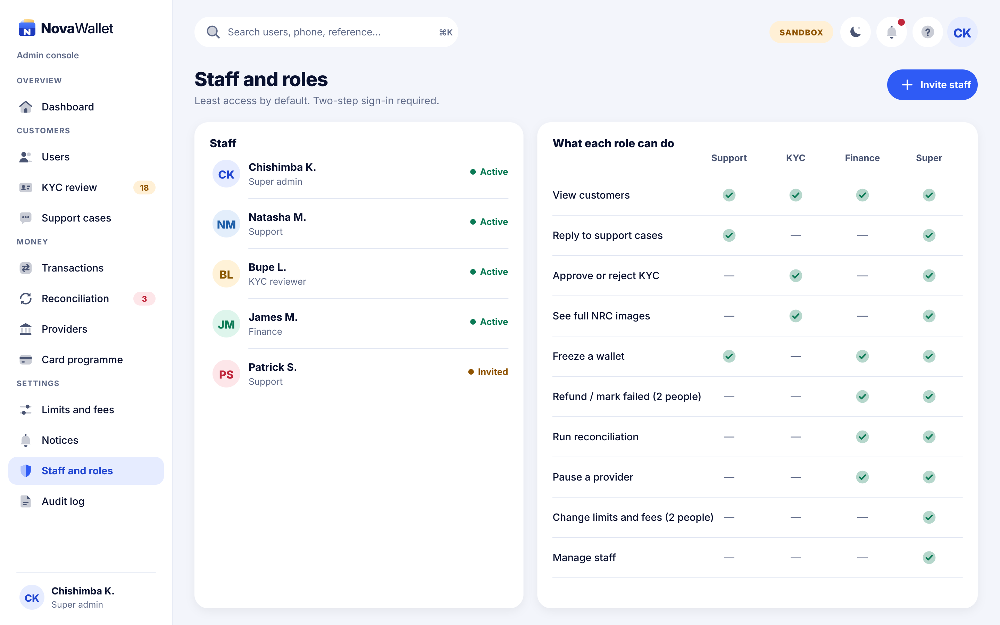
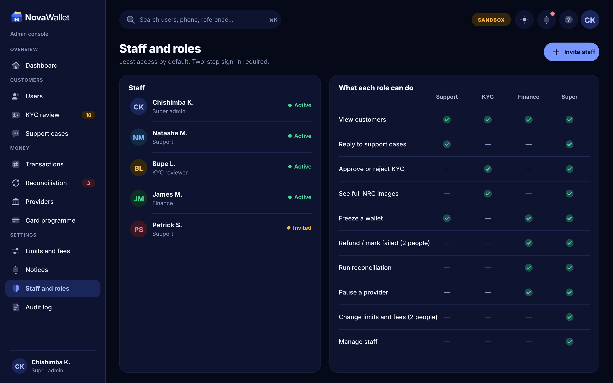

# X15 · Staff and roles (admin console)

**Route:** `/staff`  
**Canvas:** 1440 × 900 web, light and dark. Sidebar 248, content padding 32.

| Light | Dark |
|---|---|
|  |  |

## Purpose
Manage staff and what each role can do.

## Layout
1. Staff list with status.
2. Permission matrix: Support, KYC, Finance, Super.

## Behaviour
- Invite by email; first sign-in forces TOTP setup.
- Role changes need Super admin and are audited.

## Backend
- NEW admin users/roles endpoints (RBAC).

## Prompt to give opencode
```text
Build admin screen X15 "Staff and roles" at route /staff in the admin web app.
Read admin/docs/ADMIN_GUIDE.md and this BUILD.md first; open light.png and dark.png and match them.
Use the shared admin layout (sidebar, top bar, panel, data table, status text) and theme tokens only.
Implement the behaviour list, call the endpoints listed under Backend through the API client (mock any marked NEW until the backend step is done), check the user's role before showing actions, and write every action to the audit log endpoint.
Add tests (component + one end-to-end happy path). Run lint and tests, fix errors, list changed files and anything unfinished.
```
