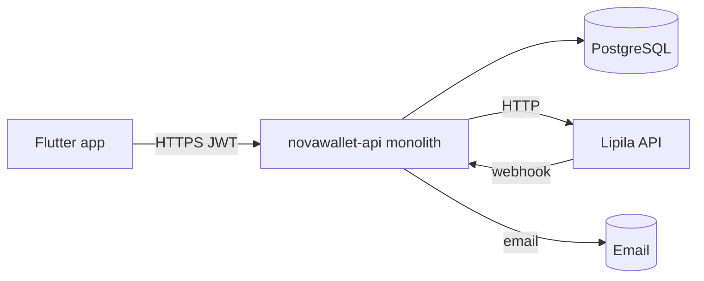
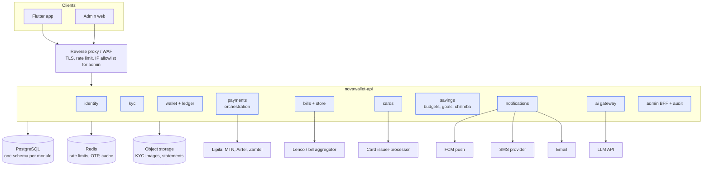
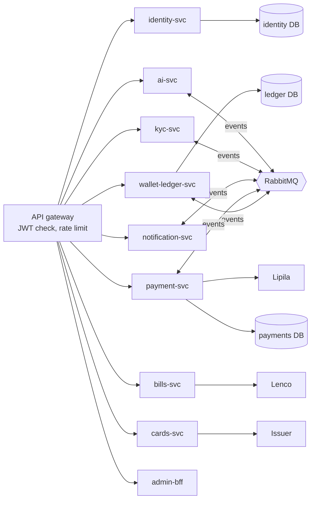

# 01 · System architecture

This builds on the docs already in your repo (`docs/architecture/current-architecture.md`, `domain-boundaries.md`, `microservices-readiness.md`, `implementation-roadmap.md`). It does not replace them; it adds the new app features (bills, cards, AI, Chilimba, admin console) and the infrastructure around them.

**Rule from your roadmap:** no phase may be skipped. The system goes **monolith → modular monolith → event-driven modular monolith → microservices**, extracting one service at a time.

---

## 1. Where you are today (verified from the repo)

| Item | Today |
|---|---|
| Runtime | Spring Boot 3.5.3, Java 17, one deployable (`novawallet-api`) |
| Database | PostgreSQL with Flyway migrations (V13 is the latest payout migration) |
| Packages | auth, user, token, security, wallet, transaction, fee, payment, kyc, notification, admin, audit, idempotency, filter, config, exception, bootstrap, common |
| Money safety done | Phase 1A guardrails; Phase 1B Batch 2 three-stage payout (A initiate → B execute with no DB transaction → C finalize), `PENDING_RECONCILIATION` |
| Payments | `LipilaGateway` (one provider); collection webhook; direct deposit **disabled** (FIN-01) |
| Known gaps | No reconciliation (S2/FIN-10), single-entry balances (FIN-08), cross-domain repository injection (ARCH-01), identity and KYC coupled (ARCH-02), no outbox/events (ARCH-03) |

---

## 2. Target in three stages

### Stage 1: Modular monolith (roadmap Phases 2–4)

One deployable, with clear modules inside it.

Rules for this stage:

- **One schema per module.** A module can only read and write its own tables. Other modules are reached through a Java interface (its "port"), never its repositories. This fixes ARCH-01; enforce it with ArchUnit tests.
- **Ledger is the source of truth** (Phase 2). The `wallets.balance` column becomes a cached projection that is checked by reconciliation.
- **Identity and KYC are separated** (ARCH-02): `users` holds login identity only; `kyc_profiles` is owned by the kyc module.

### Stage 2: Event-driven modular monolith (roadmap Phase 5)

- **Transactional outbox:** each module writes events (`TransferCompleted`, `PayoutSettled`, `KycApproved`…) to an `outbox` table in the same DB transaction as its change.
- **Relay:** a worker publishes outbox rows to a broker. Start with **RabbitMQ** (simple, cheap); Kafka is not needed at this scale.
- **Side effects move to consumers:** notifications, insights, AI tips and audit fan-out consume events instead of being called inline (fixes ARCH-03).
- **Consumers are idempotent:** each stores processed event IDs.

### Stage 3: Microservices, extracted one at a time (roadmap Phases 6–8)

Order, as in your readiness report:

1. **Notification service first:** lowest risk, already event-driven after Stage 2.
2. **Payment service:** only after the ledger and orchestration tables exist. It owns collections, payouts, provider webhooks and reconciliation, and never changes wallet balances directly. It emits `CollectionSucceeded` / `PayoutFailed`, and the ledger posts the entries.
3. **Identity + KYC services.**
4. **New services when they need to scale on their own:** bills, cards, AI. Until then they stay modules.
5. **Wallet + ledger stays the core** and is the last thing you would ever split.

**Money consistency across services:** use sagas (orchestrated by the payment service) with compensating ledger entries. There are no distributed transactions, and a payment never moves straight from pending to failed without a refund entry.

---

## 3. Module (later service) ownership

| Module | Owns tables | Main APIs | Emits | Consumes |
|---|---|---|---|---|
| identity | users, credentials, refresh_tokens, devices, otp_codes | auth, otp, pin, devices | UserRegistered, DeviceTrusted | KycApproved (raise limits) |
| kyc | kyc_profiles, kyc_documents, kyc_reviews | kyc status/upload/submit, admin review | KycApproved, KycRejected | UserRegistered |
| wallet + ledger | wallets, ledger_accounts, journal_entries, ledger_postings, limits | balance, transactions, transfers, statements | TransferCompleted, BalanceChanged | CollectionSucceeded, PayoutFailed, CardSettled |
| payments | payment_intents, collection_requests, disbursement_requests, provider_webhook_events, provider_routes | collections, payouts, name check, webhooks, reconciliation | CollectionSucceeded/Failed, PayoutSettled/Failed | — |
| bills + store | billers, bill_payments, saved_billers, store_orders | billers, validate, pay | BillPaid | — |
| cards | cards, card_controls, card_authorizations, card_waitlist | cards, controls, fund, issuer webhooks | CardAuthorized, CardSettled | KycApproved |
| savings | budgets, goals, goal_movements, roundup_settings, cash_entries, chilimba_* | budgets, goals, round-ups, chilimba | GoalReached | TransferCompleted (round-ups) |
| notifications | notifications, push_tokens, preferences, notices | notifications list, preferences, notices | — | almost every event |
| ai | ai_conversations (optional), tips, consents | chat, tips | — | monthly summaries |
| admin + audit | admin_users, roles, change_requests, audit_log | admin endpoints | — | all events (audit) |

---

## 4. Infrastructure (start small, grow later)

| Stage | Setup | Rough fit |
|---|---|---|
| Development | Docker Compose: api, postgres, redis, rabbitmq, minio (S3), mailpit, Lipila sandbox | Laptop |
| Pilot (≤ 5,000 users) | One VM (4 vCPU / 8 GB) running Docker Compose, managed PostgreSQL with daily backups and point-in-time recovery, object storage, Cloudflare (or similar) in front | Cheapest safe start |
| Growth | Two app VMs behind a load balancer (stateless app; Redis for rate limits, see SEC-09), separate worker for schedulers, read replica | When CPU > 60% or zero-downtime deploys matter |
| Scale | Kubernetes (or a managed container service) when you have more than 3 services | After Stage 3 begins |

**Hosting location:** check the data-residency rules with your licensed partner. If customer data must stay in Zambia, use a Zambian data centre or cloud region provider (VERIFY current providers and their prices). Never promise "your data stays in Zambia" in the app (A05) unless it's true.

**Always on, from the pilot:**

- TLS everywhere, HSTS, secrets in a secret manager (not `application.yml`; fixes SEC-04).
- Separate sandbox and live environments, with different databases and different Lipila keys.
- Daily backups plus a restore test every month.
- Observability:
  - Structured JSON logs with a request ID (validated; see SEC-12).
  - Metrics: Micrometer + Prometheus + Grafana.
  - Traces: OpenTelemetry.
  - Alerts: payout stuck over 30 min, webhook signature failures, reconciliation mismatch, 5xx rate.
- CI/CD: GitHub Actions runs tests → builds an image → deploys to sandbox automatically. Live deploys need manual approval.

---

## 5. Security architecture

| Area | Design |
|---|---|
| Customer auth | Short JWT access (15 min) + rotating refresh tokens stored hashed; token checks user status on each request (SEC-01); revoke all on password change (SEC-02); logout endpoint (SEC-06); `iss`/`aud` and key length enforced (SEC-08). |
| Device binding | `X-Device-Id`; new device → OTP + 24 h cooling limits. |
| PIN | Server-side hash; attempt counter and lockout in the DB, not in the app. |
| Admin | Separate JWT audience, TOTP, RBAC, maker-checker, IP allowlist. |
| Webhooks | HMAC signature + timestamp + nonce, 5-minute tolerance, stored event IDs (SEC-05), amount/currency verified against our record (FIN-02). |
| Rate limiting | Redis-backed, proxy-aware (SEC-09). |
| Input | `@Digits`/`@DecimalMax` on money (SEC-10); magic-byte check for uploads (SEC-12). |
| Secrets in logs | Never log tokens, OTPs, PINs, NRC numbers or card data (SEC-03). |
| Actuator / Swagger | Closed in prod, CORS locked to known origins (SEC-11). |
| Data | Encrypt KYC images at rest; signed URLs; PII columns encrypted where practical. |

---

## 6. Mobile app architecture (summary)

Flutter, feature-first folders, Riverpod, go_router, dio with auth/refresh/idempotency interceptors, drift for offline cache, flutter_secure_storage for tokens.

- **Offline:** cached balance with its timestamp, cached last 50 transactions, cash entries queued. Money actions need the network.
- **Idempotency:** one key per review screen. A retry reuses the key, so a timeout leads to P03 "Checking your payment" and is never retried blindly.
- **Feature flags** come from `/app/config`: cards, chilimba, store, ai.

See the ChatGPT build guide (Parts 1–4) for the step-by-step build.
