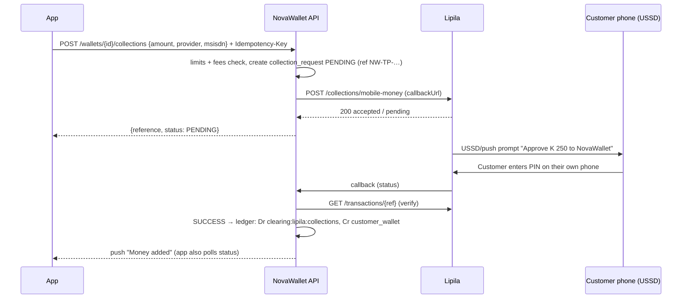

# 03 · Mobile money integration (MTN, Airtel, Zamtel)

**Short version:** keep **Lipila** as the first provider, because your backend already talks to it. Use one integration that covers MTN MoMo, Airtel Money and Zamtel Kwacha for both collections (top up) and disbursements (withdraw / send to mobile money). Add direct MTN or Airtel connections later, only if fees or reliability justify the extra work.

> Details marked **VERIFY** must be checked against the provider's current documentation and your merchant contract before you go live. Provider APIs change.

---

## 1. Options compared

| Option | Covers | Pros | Cons |
|---|---|---|---|
| **Lipila (aggregator)**, already in your repo | MTN, Airtel, Zamtel collections and disbursements; card collections; bank disbursements | One API key, one contract, sandbox ready, Flutter/other SDKs exist, your `LipilaGateway` already works | Fee on top of the telco fee; you depend on one aggregator; callbacks may not be signed (VERIFY) |
| Lenco | Collections from mobile money, payouts, bill payments | Good second provider; also useful for bills (doc on bills) | Separate contract; token via their support (VERIFY) |
| Another aggregator (e.g. pawaPay, DusuPay) | Mobile money in several African countries (Zambia coverage: VERIFY) | Failover option | Another contract and integration |
| Direct MTN MoMo API | MTN only | Lowest fees at volume; RequestToPay (collection) and Transfer (disbursement) products | Separate onboarding and KYC with MTN, separate products, sandbox → go-live process |
| Direct Airtel Money API | Airtel only | Lowest fees at volume | OAuth2, encrypted PIN for disbursement, IP whitelist, separate onboarding |
| Direct Zamtel | Zamtel only | — | Least documented; usually via an aggregator |

**Recommendation:** start with Lipila only. Build the `PaymentGateway` interface and provider router now (Phase 3), so Lenco or a direct telco can be added later as a second route without app changes. The admin Providers screen (X10) already supports one switch per provider and direction.

---

## 2. Lipila basics (as used by your code)

| Item | Value |
|---|---|
| Sandbox base URL | `https://api.lipila.dev/api/v1` (already your default in `application.yml`) |
| Production base URL | `https://blz.lipila.io/api/v1` (VERIFY with Lipila) |
| Auth | `x-api-key` header. Sandbox keys start `lsk_`, live keys `lpk_` (VERIFY) |
| Callback URL | Sent per request in the `callbackUrl` header (your `LipilaGateway` already does this) |
| Collection | `POST /collections/mobile-money` with `referenceId`, `amount`, `narration`, `accountNumber` (customer phone, e.g. 2609…), `currency` = ZMW |
| Disbursement | `POST /disbursements/mobile-money`, same fields |
| Status | `GET /transactions/{referenceId}` |
| Networks | MTN, Airtel, Zamtel (detected from the number; VERIFY whether an explicit network field is needed) |

**Callbacks may not be signed.** Treat every callback as a *hint*, not proof:

1. Accept the callback only on a secret URL path, e.g. `/webhooks/lipila/{secret}/collections`, and rate-limit it.
2. Store it in `provider_webhook_events` (raw body, headers, received time). The unique key is `referenceId + status`.
3. **Re-query `GET /transactions/{referenceId}`** from the server, and act only on what that call returns.
4. Check that the amount and currency match **our** stored request (FIN-02). If they don't match, park the money in `suspense` and raise an admin alert.

If Lipila offers signed webhooks (HMAC), verify the signature as well (SEC-05).

---

## 3. Collection (top up) flow — replaces the disabled deposit

**States:** `PENDING → SUCCESS`, `PENDING → FAILED`, or `PENDING → EXPIRED` (no answer after 10 minutes, but still re-checked for 24 h, because some providers confirm late).

**App mapping:** F05 "Check your phone", then F06 success, F07 failed or F08 still waiting.

**Rules:**

- The wallet is **never** credited before a verified SUCCESS.
- A late SUCCESS on an EXPIRED request is still credited, and the customer is notified.
- One collection per Idempotency-Key.
- Never ask for, collect or store the customer's mobile money PIN.

---

## 4. Disbursement (withdraw / send to mobile money) flow

This keeps your Batch 2 three-stage design.

| Stage | What happens | DB transaction |
|---|---|---|
| A · initiate | Check limits and PIN; **debit the wallet** into payout clearing; create the payout row `PENDING` with the idempotency key | Yes, short |
| B · execute | Call Lipila `POST /disbursements/mobile-money` | **No** DB transaction (no locks held during HTTP) |
| C · finalize | SUCCESS → `SUCCESSFUL`. Definite FAILED → `FAILED` + compensating credit (once). Timeout/unknown → `PENDING_RECONCILIATION` | Yes, short |
| D · reconcile (Batch 3) | Scheduler re-queries status with back-off, and the disbursement callback also settles. After 24 h unknown → admin queue (X09), never an automatic refund without provider confirmation | Yes |

**Name check (G07):** if the provider supports a name lookup, show the account name before sending. If not, show "We couldn't check this name" (VERIFY availability on Lipila).

**Withdraw to own number (I01):** only to numbers registered in the customer's name. Check the name at the point the number is linked (O06).

---

## 5. Reconciliation (daily and continuous)

1. **Continuous:** the scheduler re-queries every non-final collection and payout (section 3 and Stage D).
2. **Daily:** download or provide the provider statement (API or CSV from the Lipila dashboard; VERIFY), match by reference, and compare:
   - Provider SUCCESS + ours SUCCESS → matched.
   - Provider SUCCESS + ours FAILED/PENDING → **critical**: fix with a ledger entry after investigation (X08/X09, maker-checker).
   - Provider FAILED + ours SUCCESS → **critical**: money credited that never arrived; freeze the amount and investigate.
3. **Balances:** the Lipila collection balance and payout float must equal the `clearing:*` ledger accounts. Any difference goes to `suspense` and creates an alert.
4. **Float management:** alert Finance when the payout float falls below one day's average payouts. Top up the float before it runs dry, because a dry float causes failed withdrawals (S10 message).

---

## 6. Error messages customers see (map provider codes to these)

| Situation | Customer message |
|---|---|
| Customer declined / wrong PIN on phone | "The payment was declined on your phone. No money was taken." |
| Insufficient funds in mobile money | "There isn't enough money in your Airtel Money account." |
| Prompt timed out | "The prompt expired before you approved it. No money was taken." |
| Provider down / slow | "Airtel is slow right now. We'll keep checking." (never "failed") |
| Our float low (payout) | "Withdrawals to Airtel are delayed. Your money is safe." (and alert Finance) |
| Number not registered | "This number isn't registered for Airtel Money." |

---

## 7. Sandbox testing checklist

- [ ] Collection success, decline, timeout, late success after expiry.
- [ ] Duplicate callback (same ref twice) → one credit only.
- [ ] Callback with a different amount → suspense + alert, no credit.
- [ ] Payout success, definite failure (refund once), timeout → PENDING_RECONCILIATION → reconciled.
- [ ] Double tap on Confirm (same Idempotency-Key) → one request.
- [ ] Provider switched off in admin → app hides that route and shows the notice.
- [ ] 100 concurrent payouts on one wallet → no deadlock, no overdraft.

## 8. Go-live checklist (with Lipila)

- [ ] Merchant account KYB completed and live keys issued; keys stored in the secret manager.
- [ ] Callback URL is public HTTPS on the live domain; IP allowlist if Lipila publishes callback IPs (VERIFY).
- [ ] Settlement account and schedule agreed (often T+1; VERIFY).
- [ ] Fees agreed, and shown correctly in F02/G07/I01.
- [ ] Licensed partner / regulatory position confirmed (doc 06) before holding customer money.
- [ ] Runbooks: provider down, float low, stuck payouts, mismatched statement.

## 9. Going direct with MTN / Airtel later (summary)

| | MTN MoMo API | Airtel Money API |
|---|---|---|
| Products | Collection (RequestToPay), Disbursement (Transfer), separate subscriptions | Collection (USSD push), Disbursement |
| Auth | API user + key → OAuth token, per product (VERIFY) | OAuth2 client credentials; disbursement needs an encrypted PIN; IP whitelist |
| Status | Callback + `GET` status; always confirm with GET | Callback + status enquiry; always confirm with GET |
| Process | Sandbox → KYC/business docs → production credentials | Partner onboarding → UAT → production |

Implement each one as another `PaymentGateway` behind the same router. The app does not change.
