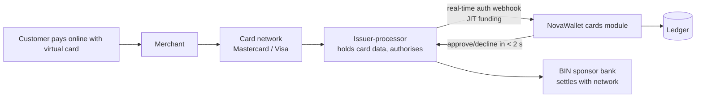

# 04 · Virtual cards

**Short version:** you can't issue Mastercard or Visa cards yourself. You partner with a **card issuer-processor (and a BIN sponsor bank)** that issues virtual cards through an API. NovaWallet then shows the card, funds it from the wallet, and applies controls. Keep the app's Cards tab on the **waitlist** (L01) until a contract is signed.

> Every provider name and capability below is a lead to **VERIFY**, not a confirmed offer. Card programmes need the partner's and the regulator's approval.

---

## 1. How card issuing works

- **BIN sponsor:** a licensed bank or e-money issuer that owns the card range and settles with the network.
- **Issuer-processor:** provides the API: create card, freeze, limits, show card details securely, authorisation webhooks, settlement files.
- **NovaWallet:** owns the customer relationship, KYC, wallet funding and controls.

## 2. Leads to research (VERIFY each)

| Lead | What was found earlier | Ask them |
|---|---|---|
| Union54 (with Paymentology) | Virtual Mastercard programme launched with a Zambian partner (ChitChat) | Do they offer card issuing-as-a-service to fintechs in Zambia now? Minimums, fees, timeline |
| Mastercard + Scale (2026 programme including Zambia) | Programme to help fintechs issue cards | Eligibility for a student fintech, partner banks in Zambia |
| Zazu (prepaid Mastercard) | Prepaid cards in Zambia | Partnership or white-label options |
| Local banks with card programmes | Some Zambian banks issue prepaid and virtual cards | BIN sponsorship for a fintech partner |
| Pan-African card APIs | Several sell virtual dollar cards in Africa | Zambia support, currency (ZMW vs USD), compliance |

**Questions to ask every partner:**

- ZMW or USD cards? FX fees?
- Pre-funded or JIT (just-in-time) authorisation?
- 3-D Secure supported?
- Secure card display SDK (so card data never touches your servers)?
- Chargeback process, monthly minimums, set-up fee, per-card and per-transaction fees.
- Settlement timing, sandbox access, and the licensing they need from you.

## 3. Funding model (choose with the partner)

| Model | How | Pros | Cons |
|---|---|---|---|
| **Pre-funded card balance** (matches design L07) | Customer moves money wallet → card balance; ledger `card:{id}` account | Simple; the partner holds the funds; easy limits | Two balances to explain |
| **JIT funding** | Card has no balance; on each authorisation the partner calls you, and you hold funds in the wallet | One balance; feels modern | Must answer in ~1–2 s with high uptime; more complex |

**Recommendation:** start pre-funded (the L03/L07 designs already assume it), and move to JIT later if the partner supports it.

## 4. PCI rules (keep your PCI scope tiny)

- **Never** store, log or transmit the full card number (PAN), CVV or expiry through your servers.
- Show card details (L04) with the issuer's **secure display** (an iframe/SDK or tokenised view). The app only receives a short-lived token.
- Store only the card ID, last 4 digits, expiry month/year (if allowed), status and controls.
- With this design you usually qualify for the smallest PCI DSS self-assessment. Confirm with the partner.

## 5. Card module design (cards module / later cards-svc)

| Table | Fields |
|---|---|
| `cards` | id, user_id, partner_card_id, last4, design (blue/midnight/gold/sky), status (ACTIVE, FROZEN, CANCELLED), created_at |
| `card_controls` | card_id, online, international, subscriptions, monthly_limit, blocked_mccs |
| `card_authorizations` | id, card_id, partner_auth_id, amount, currency, merchant, mcc, decision, reason, created_at |
| `card_settlements` | partner_txn_id, auth_id, amount, settled_at |
| `card_waitlist` | user_id, joined_at |

| Endpoint | Screen |
|---|---|
| `POST /cards/waitlist` | L01 |
| `POST /cards` (create; needs Verified level) | L02 |
| `GET /cards`, `GET /cards/{id}/transactions` | L03 |
| `POST /cards/{id}/reveal-token` → secure display token | L04 |
| `PATCH /cards/{id}/controls` | L05 |
| `POST /cards/{id}/freeze`, `/unfreeze` | L06 |
| `POST /cards/{id}/fund` (+ Idempotency-Key) | L07 |
| `POST /webhooks/cards/{partner}` (auth/settlement events, signed) | — |

**Authorisation rules** (if JIT, or for your own checks in pre-funded mode):

- Decline if the card is frozen.
- Decline if a control blocks it: online off, international off, blocked MCC, or over the monthly limit.
- Decline if there isn't enough balance.
- Always answer within the partner's timeout. If unsure, the default is to decline.

**Disputes:** a "Report a problem" on a card transaction (J06) opens a dispute case. Finance submits it to the partner, and the status shows in the app.

## 6. Launch steps (also shown on admin X16)

1. Partner contract signed + BIN sponsor confirmed.
2. Regulatory approval via partner (doc 06).
3. Sandbox integration (create, freeze, fund, auth webhooks, settlement files).
4. Secure display working on Android and iOS.
5. Fees approved and shown in L02.
6. Chargeback process written.
7. Pilot with 100 waitlist users → monitor declines and fraud → open to all Verified users.
