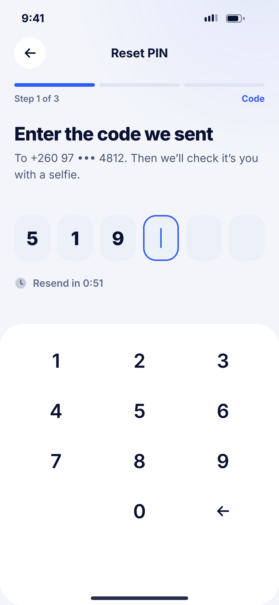
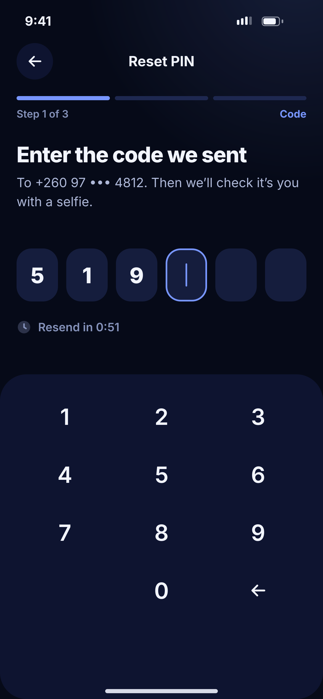

# Q01 · Reset PIN – code

**Flow:** Extra flows  
**Route:** `/pin/reset`  
**Design files:** `light.png`, `dark.png` (3×, 1170 × 2532) and `light.svg`, `dark.svg` in this folder.

| Light | Dark |
|---|---|
|  |  |

## Purpose
Step 1 of 3 to reset a forgotten or locked PIN: confirm the phone.

## Layout (top to bottom, 390 × 844 canvas, 20 side padding)
1. TopBar “Reset PIN”, NwStepProgress 3 steps (Code, Selfie, New PIN).
2. H1 “Enter the code we sent” + sub.
3. NwOtpBoxes; resend countdown.
4. Surface panel with NwKeypad.

## Components used (see ../../../docs/COMPONENTS.md)
- NwStepProgress
- NwOtpBoxes
- NwKeypad

## States and behaviour
- Same OTP states as B02 (wrong, expired, resend).

## Navigation
| When | Go to |
|---|---|
| Correct code | Q02 Selfie |

## Data and backend
- `POST /auth/otp/send` {purpose: PIN_RESET}, `POST /auth/otp/verify` → otpToken.

## Rules and notes
- Reached from C02 “Forgot PIN?”, C07 “Reset PIN” and O03.

## Done when
- Matches `light.png` and `dark.png` side by side at 390 × 844 (spacing within 2 px, same colours from theme tokens).
- Works at text scale 1.3× without clipping, and on a 360-wide Android phone.
- Every state listed above can be reached (use a debug menu or fake repository).
- TalkBack reads every button and field with a clear label.
- No hard-coded colours, strings (all in ARB files) or limits.

## Prompt to give opencode (paste as is)
```text
Build screen Q01 "Reset PIN – code" for the NovaWallet Flutter app (route /pin/reset).
Read docs/COMPONENTS.md and this file (screens/.../Q01_reset_pin_code/BUILD.md) first, and open light.png and dark.png to match the design exactly.
Use only the shared components from lib/core/ui and colours from the theme extension; if a component is missing, build it in lib/core/ui first.
Put the screen in the feature folder for "Extra flows" following the existing architecture (presentation / application / data layers, Riverpod for state, go_router for navigation).
Implement every state listed under "States and behaviour", the navigation table, and the data calls listed under "Data and backend" through a repository interface with a fake implementation for now if the endpoint is marked NEW.
Add all text to the ARB localisation files. Add a widget test that pumps the screen in light and dark and a golden test for each.
Do not change other screens. When finished, list the files you created or changed and anything you could not complete.
```
