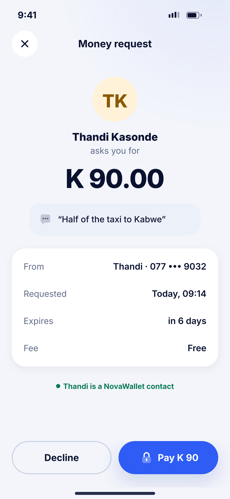
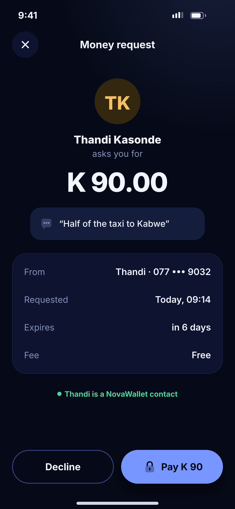

# Q05 · Incoming money request

**Flow:** Extra flows  
**Route:** `/requests/:id`  
**Design files:** `light.png`, `dark.png` (3×, 1170 × 2532) and `light.svg`, `dark.svg` in this folder.

| Light | Dark |
|---|---|
|  |  |

## Purpose
Someone asked the user for money (from G08/G09).

## Layout (top to bottom, 390 × 844 canvas, 20 side padding)
1. Close button, “Money request”.
2. Requester avatar 38, name, “asks you for”.
3. Amount 44/800.
4. Note box (surface2) with chat icon.
5. NwKeyValueCard: From, Requested, Expires, Fee.
6. Status text “… is a NovaWallet contact”.
7. Two buttons: outline Decline, primary “Pay K 90” with lock.

## Components used (see ../../../docs/COMPONENTS.md)
- NwAvatar
- NwKeyValueCard
- NwButton

## States and behaviour
- Unknown requester → warning status “Not in your contacts. Check before paying.”
- Expired or already paid → read-only with status.

## Navigation
| When | Go to |
|---|---|
| Pay | PIN sheet (G04) → G06 success |
| Decline | Confirm sheet → back; requester notified |

## Data and backend
- `GET /payment-requests/{id}`, `POST /payment-requests/{id}/pay` (+Idempotency-Key), `/decline`.

## Rules and notes
- Opened from push or E06.

## Done when
- Matches `light.png` and `dark.png` side by side at 390 × 844 (spacing within 2 px, same colours from theme tokens).
- Works at text scale 1.3× without clipping, and on a 360-wide Android phone.
- Every state listed above can be reached (use a debug menu or fake repository).
- TalkBack reads every button and field with a clear label.
- No hard-coded colours, strings (all in ARB files) or limits.

## Prompt to give opencode (paste as is)
```text
Build screen Q05 "Incoming money request" for the NovaWallet Flutter app (route /requests/:id).
Read docs/COMPONENTS.md and this file (screens/.../Q05_incoming_request/BUILD.md) first, and open light.png and dark.png to match the design exactly.
Use only the shared components from lib/core/ui and colours from the theme extension; if a component is missing, build it in lib/core/ui first.
Put the screen in the feature folder for "Extra flows" following the existing architecture (presentation / application / data layers, Riverpod for state, go_router for navigation).
Implement every state listed under "States and behaviour", the navigation table, and the data calls listed under "Data and backend" through a repository interface with a fake implementation for now if the endpoint is marked NEW.
Add all text to the ARB localisation files. Add a widget test that pumps the screen in light and dark and a golden test for each.
Do not change other screens. When finished, list the files you created or changed and anything you could not complete.
```
