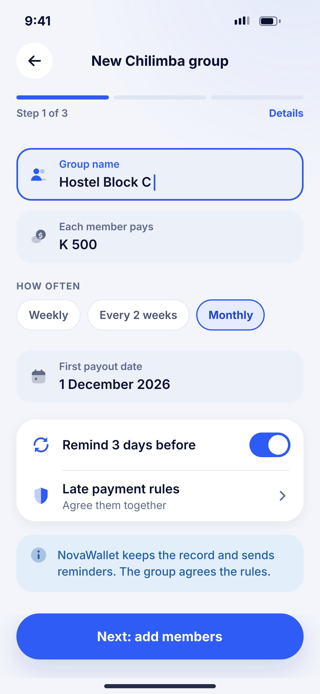
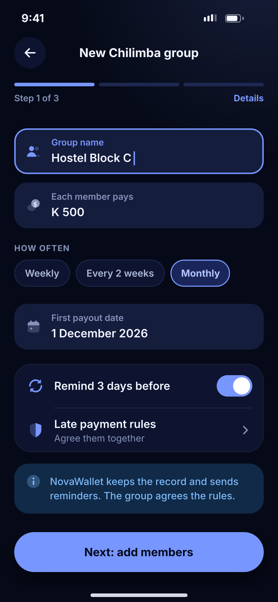

# Q06 · New Chilimba – details

**Flow:** Extra flows  
**Route:** `/chilimba/new`  
**Design files:** `light.png`, `dark.png` (3×, 1170 × 2532) and `light.svg`, `dark.svg` in this folder.

| Light | Dark |
|---|---|
|  |  |

## Purpose
Create a Chilimba group: step 1.

## Layout (top to bottom, 390 × 844 canvas, 20 side padding)
1. TopBar, NwStepProgress (Details, Members, Review).
2. Fields: Group name, Each member pays, First payout date.
3. Overline “How often” + chips.
4. List group: reminder toggle, late payment rules.
5. Info banner about NovaWallet’s role.
6. NwBottomCta “Next: add members”.

## Components used (see ../../../docs/COMPONENTS.md)
- NwField
- Chips
- NwListGroup
- NwBanner

## States and behaviour
- Validation: amount K 10–K 5,000; name 3–40 characters.

## Navigation
| When | Go to |
|---|---|
| Next | Q07 |

## Data and backend
- Held locally until review.

## Rules and notes
- Tracker only until the partner approves pooled collections (compliance doc).

## Done when
- Matches `light.png` and `dark.png` side by side at 390 × 844 (spacing within 2 px, same colours from theme tokens).
- Works at text scale 1.3× without clipping, and on a 360-wide Android phone.
- Every state listed above can be reached (use a debug menu or fake repository).
- TalkBack reads every button and field with a clear label.
- No hard-coded colours, strings (all in ARB files) or limits.

## Prompt to give opencode (paste as is)
```text
Build screen Q06 "New Chilimba – details" for the NovaWallet Flutter app (route /chilimba/new).
Read docs/COMPONENTS.md and this file (screens/.../Q06_chilimba_create/BUILD.md) first, and open light.png and dark.png to match the design exactly.
Use only the shared components from lib/core/ui and colours from the theme extension; if a component is missing, build it in lib/core/ui first.
Put the screen in the feature folder for "Extra flows" following the existing architecture (presentation / application / data layers, Riverpod for state, go_router for navigation).
Implement every state listed under "States and behaviour", the navigation table, and the data calls listed under "Data and backend" through a repository interface with a fake implementation for now if the endpoint is marked NEW.
Add all text to the ARB localisation files. Add a widget test that pumps the screen in light and dark and a golden test for each.
Do not change other screens. When finished, list the files you created or changed and anything you could not complete.
```
