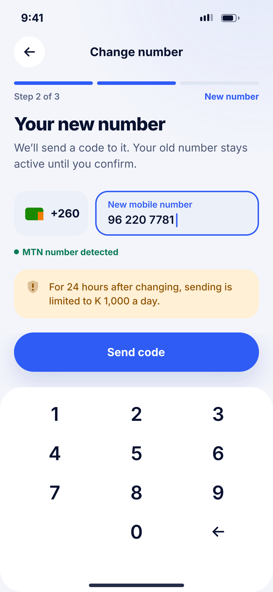
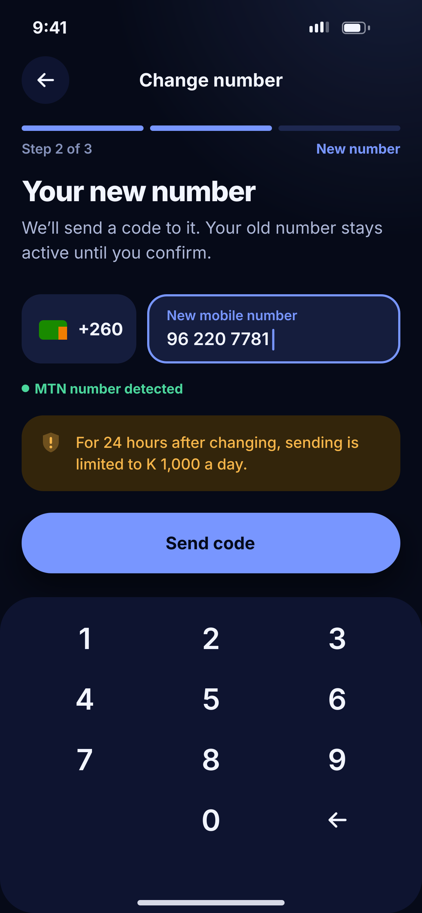

# Q10 · Change phone number

**Flow:** Extra flows  
**Route:** `/me/details/phone`  
**Design files:** `light.png`, `dark.png` (3×, 1170 × 2532) and `light.svg`, `dark.svg` in this folder.

| Light | Dark |
|---|---|
|  |  |

## Purpose
Move the account to a new number safely.

## Layout (top to bottom, 390 × 844 canvas, 20 side padding)
1. TopBar, NwStepProgress (Old number, New number, Confirm), step 2 active.
2. H1 “Your new number” + sub.
3. +260 box + new number field; network status text.
4. Warning banner about 24 h limit.
5. Primary “Send code”.
6. Surface panel keypad.

## Components used (see ../../../docs/COMPONENTS.md)
- NwStepProgress
- NwField
- NwBanner
- NwKeypad

## States and behaviour
- Step 1 confirms a code on the old number (or selfie if the old SIM is lost).
- Number already used → error.

## Navigation
| When | Go to |
|---|---|
| Code verified | Success → O02 |

## Data and backend
- NEW `POST /users/me/phone/change` (start), OTP verify for old + new, `POST /users/me/phone/confirm`.

## Rules and notes
- Linked mobile money numbers are re-checked by name after the change.

## Done when
- Matches `light.png` and `dark.png` side by side at 390 × 844 (spacing within 2 px, same colours from theme tokens).
- Works at text scale 1.3× without clipping, and on a 360-wide Android phone.
- Every state listed above can be reached (use a debug menu or fake repository).
- TalkBack reads every button and field with a clear label.
- No hard-coded colours, strings (all in ARB files) or limits.

## Prompt to give opencode (paste as is)
```text
Build screen Q10 "Change phone number" for the NovaWallet Flutter app (route /me/details/phone).
Read docs/COMPONENTS.md and this file (screens/.../Q10_change_phone/BUILD.md) first, and open light.png and dark.png to match the design exactly.
Use only the shared components from lib/core/ui and colours from the theme extension; if a component is missing, build it in lib/core/ui first.
Put the screen in the feature folder for "Extra flows" following the existing architecture (presentation / application / data layers, Riverpod for state, go_router for navigation).
Implement every state listed under "States and behaviour", the navigation table, and the data calls listed under "Data and backend" through a repository interface with a fake implementation for now if the endpoint is marked NEW.
Add all text to the ARB localisation files. Add a widget test that pumps the screen in light and dark and a golden test for each.
Do not change other screens. When finished, list the files you created or changed and anything you could not complete.
```
