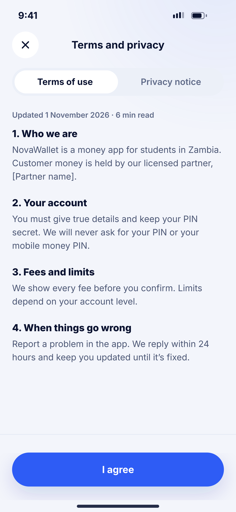
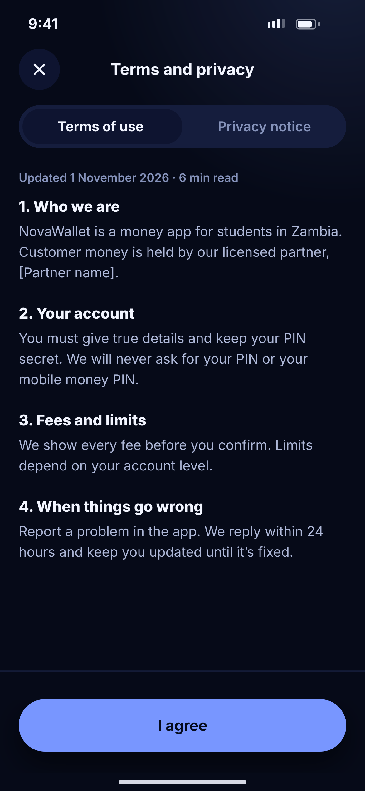

# Q12 · Terms and privacy

**Flow:** Extra flows  
**Route:** `/legal`  
**Design files:** `light.png`, `dark.png` (3×, 1170 × 2532) and `light.svg`, `dark.svg` in this folder.

| Light | Dark |
|---|---|
|  |  |

## Purpose
Readable, native terms and privacy notice (not a raw web page).

## Layout (top to bottom, 390 × 844 canvas, 20 side padding)
1. TopBar with close.
2. Segmented: Terms of use | Privacy notice.
3. Updated date + read time.
4. Numbered sections: heading 16/800, body 14.5 text2.
5. Pinned bottom area with NwBottomCta “I agree” (only when shown during sign-up or after an update).

## Components used (see ../../../docs/COMPONENTS.md)
- Segmented control
- Markdown renderer

## States and behaviour
- Content loaded from server (markdown) and cached offline; version number stored with acceptance.

## Navigation
| When | Go to |
|---|---|
| I agree | Back to the flow that opened it |

## Data and backend
- NEW `GET /legal/{terms|privacy}`, `POST /legal/accept {version}`.

## Rules and notes
- Legal text must be written/approved by a lawyer; the design shows placeholder copy.

## Done when
- Matches `light.png` and `dark.png` side by side at 390 × 844 (spacing within 2 px, same colours from theme tokens).
- Works at text scale 1.3× without clipping, and on a 360-wide Android phone.
- Every state listed above can be reached (use a debug menu or fake repository).
- TalkBack reads every button and field with a clear label.
- No hard-coded colours, strings (all in ARB files) or limits.

## Prompt to give opencode (paste as is)
```text
Build screen Q12 "Terms and privacy" for the NovaWallet Flutter app (route /legal).
Read docs/COMPONENTS.md and this file (screens/.../Q12_terms_privacy/BUILD.md) first, and open light.png and dark.png to match the design exactly.
Use only the shared components from lib/core/ui and colours from the theme extension; if a component is missing, build it in lib/core/ui first.
Put the screen in the feature folder for "Extra flows" following the existing architecture (presentation / application / data layers, Riverpod for state, go_router for navigation).
Implement every state listed under "States and behaviour", the navigation table, and the data calls listed under "Data and backend" through a repository interface with a fake implementation for now if the endpoint is marked NEW.
Add all text to the ARB localisation files. Add a widget test that pumps the screen in light and dark and a golden test for each.
Do not change other screens. When finished, list the files you created or changed and anything you could not complete.
```
